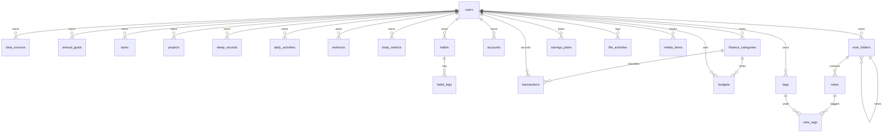

# 生活台 · Life Console — 后端接口与数据库设计

> 状态：**待评审**
> 依据：当前 `Frontend` 已完成的 7 个页面、`src/mock/`、`src/stores/`、`src/types/index.ts`
> 目标技术栈：Spring Boot 3 + MySQL 8 + Flyway
> 阶段定位：Mock 前端交互已完成，本文档作为「API Contract + 数据库设计」的评审基线，评审通过后再进入后端实现。

***

## 1. 范围与结论

### 1.1 本文档覆盖

- 从现有前端视图反推的领域模型
- MySQL 8 表结构（22 张表）与索引约定
- REST API 清单（约 40 个端点）与关键请求/响应示例
- 前端 Mock → API 的替换路径
- 聚合口径与计算规则
- 实施阶段划分与待确认项

### 1.2 不在本次范围

- 登录 / 注册 / 权限体系（MVP 单用户，表结构预留 `user_id`）
- 财务 / 健康第三方 API 的真实对接
- Obsidian 同步实现
- 部署、监控、备份策略

### 1.3 核心设计结论

1. **双层接口**：每个页面提供一个「页面聚合接口」，返回与当前 store 完全一致的视图模型；交互写操作走独立的「资源接口」。这样前端替换 Mock 时不需要改组件。
2. **任务单一数据源**：目前首页 `mockTodayTasks` 与工作页 `mockWorkTodos` 是两份独立数据（同一文案、不同 id、不同 localStorage key）。后端统一为 `tasks` 表，首页与工作页共享，彻底解决跨页状态不一致。
3. **能算不存**：预算使用额、年度目标进度、储蓄进度、习惯进度、支出结构等全部由资源表实时聚合，避免冗余字段漂移。
4. **单用户 MVP**：所有业务表带 `user_id`，服务端固定当前用户；引入登录时不需要改表结构。
5. **金额用字符串**：API 中金额统一返回 `"38.00"` 形式的字符串，避免 JSON Number 精度问题；数据库用 `DECIMAL(12,2)`。
6. **时间统一**：数据库存 UTC `DATETIME(3)`，API 返回带 `+08:00` 偏移的 ISO 8601；纯日期用 `YYYY-MM-DD`。

***

## 2. 现状盘点：Mock 数据 → 存储方式

| 页面 | 数据                    | 处理方式                                     |
| -- | --------------------- | ---------------------------------------- |
| 首页 | 问候/日期/文案 chips        | 聚合生成（文案可前端兜底，见待确认项）                      |
| 首页 | 4 个指标卡（睡眠/支出/步数/连续记录） | 由健康、财富、用户表聚合                             |
| 首页 | 今年小目标（读书/跑步/储蓄/旅行）    | `annual_goals` 存目标，进度按规则实时计算             |
| 首页 | 收支趋势近 6 月             | `transactions` 按月聚合                      |
| 首页 | 今天要做（可勾选）             | `tasks`（与工作页共用）                          |
| 首页 | 支出结构 Top 4            | `transactions` + `finance_categories` 聚合 |
| 首页 | 阅读/观影进度               | `media_items`                            |
| 首页 | 最近笔记                  | `notes` 按 `updated_at` 倒序                |
| 健康 | Hero 文案 + mini 卡      | 聚合生成                                     |
| 健康 | 本周睡眠趋势（深/浅/REM）       | `sleep_records` 按周聚合                     |
| 健康 | 本月运动时长（按周、按类型）        | `workouts` 聚合                            |
| 健康 | 体重曲线                  | `body_metrics`                           |
| 健康 | 最近睡眠记录                | `sleep_records`                          |
| 健康 | 习惯打卡（可点击）             | `habits` + `habit_logs`                  |
| 财富 | 总资产 / 收入 / 支出 / 结余    | `accounts` + `transactions` 聚合           |
| 财富 | 本月按周收支 / 近 6 月支出      | `transactions` 聚合                        |
| 财富 | 支出分类占比                | `transactions` + `finance_categories`    |
| 财富 | 储蓄目标（年度/月度/连续）        | `savings_plans` 存目标，进度实时计算               |
| 财富 | 最近交易                  | `transactions`                           |
| 财富 | 预算使用                  | `budgets` 存限额，使用额实时计算                    |
| 工作 | Banner chips          | 聚合生成（专注时长暂不建模，见 §11）                     |
| 工作 | 月历事件                  | 由 `tasks.scheduled_date / due_at` 派生     |
| 工作 | 今日待办（可勾选）             | `tasks`（area=work）                       |
| 工作 | 即将到期                  | `tasks.due_at` 派生                        |
| 工作 | 项目进度                  | `projects`                               |
| 生活 | Banner / 指标卡          | 聚合生成                                     |
| 生活 | 月度活动分布                | `life_activities` 聚合                     |
| 生活 | 内容类型占比                | `media_items` 聚合                         |
| 生活 | 阅读/观影进度               | `media_items`（status=in\_progress）       |
| 生活 | 最近完播/读完               | `media_items`（status=finished）           |
| 笔记 | 指标行 4 项               | `notes` / `tags` 聚合                      |
| 笔记 | 目录树 + 计数              | `note_folders`，计数递归聚合                    |
| 笔记 | 最近笔记列表                | `notes` 按 folder 过滤                      |
| 笔记 | 笔记正文 + 标签             | `notes` + `note_tags` + `tags`           |
| 笔记 | 标签分布 Top 8            | `note_tags` 聚合                           |
| 设置 | 个人资料 / 主题             | `users`                                  |
| 设置 | 数据源状态                 | `data_sources`                           |
| 设置 | 版本 / 技术栈 / 更新时间       | 前端常量 + 服务端构建信息，不建表                       |

**不落库（前端静态展示）**：`mockAppMeta.version / techStack`、图表调色板、状态 pill 颜色映射、`mockLifeMetrics` 中的「本周游戏时长」。

***

## 3. 总体设计

### 3.1 接口分层

**A. 页面聚合接口（BFF，只读）**

| 接口                            | 对应页面 / store                      |
| ----------------------------- | --------------------------------- |
| `GET /api/v1/dashboard`       | DashboardView / useDashboardStore |
| `GET /api/v1/health/overview` | HealthView / useHealthStore       |
| `GET /api/v1/wealth/overview` | WealthView / useWealthStore       |
| `GET /api/v1/work/overview`   | WorkView / useWorkStore           |
| `GET /api/v1/life/overview`   | LifeView / useLifeStore           |
| `GET /api/v1/notes/overview`  | NotesView / useNotesStore         |
| `GET /api/v1/me`              | SettingsView / useAppStore        |

聚合接口的响应结构与当前 store state **逐字段对齐**（包括 `valueText`、`percent`、`color` 等展示字段），前端只需把 `state()` 的 mock 初始化替换为 `fetch`。

**B. 资源接口（读写）**

`tasks`、`habits`、`transactions`、`budgets`、`projects`、`media`、`activities`、`notes`、`note-folders`、`note-tags`、`users`、`data-sources` 分别提供标准 CRUD / 局部更新。

### 3.2 通用约定

| 项            | 约定                                                                          |
| ------------ | --------------------------------------------------------------------------- |
| Base URL     | `http://localhost:8080/api/v1`                                              |
| 版本           | 路径版本 `/v1`                                                                  |
| 认证           | MVP：无认证，服务端固定为种子用户；后续 `Authorization: Bearer <JWT>`                         |
| Content-Type | `application/json; charset=utf-8`                                           |
| 成功响应         | 直接返回资源对象或数组，不额外包 `{code,data}` 外壳                                           |
| 错误响应         | RFC 7807 `application/problem+json`                                         |
| 分页           | `?page=1&size=20`，响应 `{ "items": [], "page": 1, "size": 20, "total": 128 }` |
| 排序           | `?sort=field,asc`，仅白名单字段生效                                                  |
| ID           | 服务端 `BIGINT`，API 中序列化为**字符串**（与现有 `Task.id: string` 对齐，避免 JS 精度问题）          |
| 金额           | 字符串十进制，如 `"38.00"`；币种固定 CNY                                                 |
| 日期           | `YYYY-MM-DD`；月份参数 `YYYY-MM`                                                 |
| 时间戳          | ISO 8601 带偏移，如 `2025-06-12T23:40:00+08:00`                                  |
| 布尔           | JSON `true/false`，数据库 `TINYINT(1)`                                          |
| 软删除          | `notes / tasks / transactions / media_items` 使用 `deleted_at`；列表默认过滤         |
| 幂等           | 打卡使用 `PUT`；任务勾选使用 `PATCH { "done": true }`（传目标值而非 toggle）                   |
| CORS         | 开发期允许 `http://localhost:5173`                                               |

**错误示例**

```json
{
  "type": "https://life-console.dev/errors/validation",
  "title": "请求参数校验失败",
  "status": 400,
  "detail": "priority 不是合法值",
  "instance": "/api/v1/tasks",
  "errors": [
    { "field": "priority", "message": "must be one of high, mid, low" }
  ]
}
```

***

## 4. 领域模型与 ER 关系



表分组：

- 用户与设置：`users`、`data_sources`
- 通用目标与任务：`annual_goals`、`tasks`、`projects`
- 健康：`sleep_records`、`daily_activities`、`workouts`、`body_metrics`、`habits`、`habit_logs`
- 财富：`accounts`、`finance_categories`、`transactions`、`budgets`、`savings_plans`
- 生活：`life_activities`、`media_items`
- 笔记：`note_folders`、`notes`、`tags`、`note_tags`

***

## 5. 数据库表设计

### 5.1 全局约定

| 项        | 约定                                                                                                             |
| -------- | -------------------------------------------------------------------------------------------------------------- |
| 引擎 / 字符集 | InnoDB，`utf8mb4`，排序规则 `utf8mb4_0900_ai_ci`                                                                     |
| 主键       | `id BIGINT UNSIGNED NOT NULL AUTO_INCREMENT`                                                                   |
| 外键       | 均建 FK；日志类子表 `ON DELETE CASCADE`，其余 `RESTRICT`                                                                  |
| 时间列      | `created_at DATETIME(3) NOT NULL DEFAULT CURRENT_TIMESTAMP(3)`；`updated_at ... ON UPDATE CURRENT_TIMESTAMP(3)` |
| 枚举       | 用 `VARCHAR(8/16)` + 应用层枚举，不使用 MySQL `ENUM`，便于演进                                                                |
| 金额       | `DECIMAL(12,2)`（资产类 `DECIMAL(14,2)`）                                                                           |
| 百分比      | `DECIMAL(5,2)`，范围 0–100，仅存原始比率时使用                                                                              |
| 颜色       | 存前端 token：`green / blue / yellow / pink / danger / gray`                                                       |
| 索引命名     | `idx_表_列`、`uk_表_列`                                                                                             |

### 5.2 用户与设置

#### users

| 列                     | 类型                | 约束                               | 说明                           |
| --------------------- | ----------------- | -------------------------------- | ---------------------------- |
| id                    | BIGINT UNSIGNED   | PK                               | <br />                       |
| username              | VARCHAR(64)       | NOT NULL, UNIQUE                 | 登录名预留，MVP 种子 `lin`           |
| display\_name         | VARCHAR(64)       | NOT NULL                         | 昵称，首页问候使用                    |
| avatar\_char          | VARCHAR(8)        | NULL                             | 头像字符，如 `L`；后续可换 `avatar_url` |
| signature             | VARCHAR(200)      | NULL                             | 签名                           |
| target\_year          | SMALLINT UNSIGNED | NOT NULL                         | 目标年份                         |
| theme                 | VARCHAR(16)       | NOT NULL DEFAULT 'light'         | `light/dark/system`          |
| timezone              | VARCHAR(64)       | NOT NULL DEFAULT 'Asia/Shanghai' | 聚合口径依赖                       |
| current\_streak\_days | SMALLINT UNSIGNED | NOT NULL DEFAULT 0               | 连续记录天数，写操作时维护                |
| longest\_streak\_days | SMALLINT UNSIGNED | NOT NULL DEFAULT 0               | 历史最长                         |
| last\_active\_on      | DATE              | NULL                             | 最近活跃日期，用于连续性判定               |
| created\_at           | DATETIME(3)       | NOT NULL                         | `usedDays` = 今天 − 创建日 + 1    |
| updated\_at           | DATETIME(3)       | NOT NULL                         | <br />                       |

索引：`uk_users_username (username)`。

#### data\_sources

| 列                         | 类型              | 约束                 | 说明                                                      |
| ------------------------- | --------------- | ------------------ | ------------------------------------------------------- |
| id                        | BIGINT UNSIGNED | PK                 | <br />                                                  |
| user\_id                  | BIGINT UNSIGNED | NOT NULL, FK users | <br />                                                  |
| source\_type              | VARCHAR(32)     | NOT NULL           | `finance_api / health_api / obsidian`                   |
| name                      | VARCHAR(64)     | NOT NULL           | 显示名                                                     |
| description               | VARCHAR(255)    | NULL               | 说明                                                      |
| status                    | VARCHAR(16)     | NOT NULL           | `disconnected / connected / readonly / syncing / error` |
| config\_json              | JSON            | NULL               | 非敏感配置（路径、端点）                                            |
| secret\_cipher            | VARBINARY(1024) | NULL               | Token 等敏感信息，AES-GCM 加密后存储                               |
| last\_synced\_at          | DATETIME(3)     | NULL               | <br />                                                  |
| created\_at / updated\_at | DATETIME(3)     | NOT NULL           | <br />                                                  |

索引：`uk_data_sources_user_type (user_id, source_type)`。

> 图标、图标底色等纯展示字段不入库，由前端按 `source_type` 映射。

### 5.3 目标、任务与项目

#### annual\_goals

| 列             | 类型                | 约束                 | 说明                                                            |
| ------------- | ----------------- | ------------------ | ------------------------------------------------------------- |
| id            | BIGINT UNSIGNED   | PK                 | <br />                                                        |
| user\_id      | BIGINT UNSIGNED   | NOT NULL, FK       | <br />                                                        |
| year          | SMALLINT UNSIGNED | NOT NULL           | <br />                                                        |
| name          | VARCHAR(32)       | NOT NULL           | 读书 / 跑步 / 储蓄 / 旅行                                             |
| metric\_key   | VARCHAR(32)       | NOT NULL           | `books_finished / running_km / savings_amount / travel_count` |
| unit          | VARCHAR(16)       | NOT NULL           | 本 / km / CNY / 次                                              |
| target\_value | DECIMAL(14,2)     | NOT NULL           | <br />                                                        |
| color         | VARCHAR(16)       | NOT NULL           | 前端进度条配色                                                       |
| sort\_order   | TINYINT UNSIGNED  | NOT NULL DEFAULT 0 | <br />                                                        |

索引：`uk_annual_goals_user_year_name (user_id, year, name)`。

> 当前值不落库，按 `metric_key` 实时计算（规则见 §8.3）。

#### tasks

| 列                         | 类型              | 约束                         | 说明                               |
| ------------------------- | --------------- | -------------------------- | -------------------------------- |
| id                        | BIGINT UNSIGNED | PK                         | <br />                           |
| user\_id                  | BIGINT UNSIGNED | NOT NULL, FK               | <br />                           |
| title                     | VARCHAR(255)    | NOT NULL                   | 任务文案                             |
| note                      | VARCHAR(1000)   | NULL                       | 备注                               |
| area                      | VARCHAR(16)     | NOT NULL DEFAULT 'general' | `work / health / life / general` |
| priority                  | VARCHAR(8)      | NOT NULL DEFAULT 'mid'     | `high / mid / low`               |
| is\_done                  | TINYINT(1)      | NOT NULL DEFAULT 0         | <br />                           |
| scheduled\_date           | DATE            | NULL                       | 归属日期，「今天要做」按此过滤                  |
| due\_at                   | DATETIME(3)     | NULL                       | 截止时间，派生「即将到期」和日历 DDL             |
| completed\_at             | DATETIME(3)     | NULL                       | 完成时间                             |
| sort\_order               | INT             | NOT NULL DEFAULT 0         | 同优先级内排序                          |
| created\_at / updated\_at | DATETIME(3)     | NOT NULL                   | <br />                           |
| deleted\_at               | DATETIME(3)     | NULL                       | <br />                           |

索引：

- `idx_tasks_user_scheduled (user_id, scheduled_date, is_done)`
- `idx_tasks_user_due (user_id, due_at)`
- `idx_tasks_user_done_priority (user_id, is_done, priority)`

> 首页 `mockTodayTasks` 与工作页 `mockWorkTodos` 中重复的任务（如「提交本周周报」「写 Q2 产品复盘文档」）在种子数据中**只保留一条**，通过 `area` 区分归属。

#### projects

| 列                         | 类型              | 约束                        | 说明                       |
| ------------------------- | --------------- | ------------------------- | ------------------------ |
| id                        | BIGINT UNSIGNED | PK                        | <br />                   |
| user\_id                  | BIGINT UNSIGNED | NOT NULL, FK              | <br />                   |
| name                      | VARCHAR(128)    | NOT NULL                  | <br />                   |
| stage                     | VARCHAR(64)     | NULL                      | 自由文本，如 `交互稿`、`42/168`    |
| progress\_percent         | DECIMAL(5,2)    | NOT NULL DEFAULT 0        | 0–100                    |
| status                    | VARCHAR(16)     | NOT NULL DEFAULT 'active' | `active / paused / done` |
| start\_date               | DATE            | NULL                      | <br />                   |
| target\_date              | DATE            | NULL                      | <br />                   |
| color                     | VARCHAR(16)     | NOT NULL DEFAULT 'green'  | <br />                   |
| sort\_order               | INT             | NOT NULL DEFAULT 0        | <br />                   |
| created\_at / updated\_at | DATETIME(3)     | NOT NULL                  | <br />                   |

索引：`idx_projects_user_status (user_id, status)`。

### 5.4 健康

#### sleep\_records

| 列                 | 类型                | 约束                        | 说明                                   |
| ----------------- | ----------------- | ------------------------- | ------------------------------------ |
| id                | BIGINT UNSIGNED   | PK                        | <br />                               |
| user\_id          | BIGINT UNSIGNED   | NOT NULL, FK              | <br />                               |
| sleep\_date       | DATE              | NOT NULL                  | 归属日期（以起床日为准）                         |
| sleep\_at         | DATETIME(3)       | NOT NULL                  | 入睡时间                                 |
| wake\_at          | DATETIME(3)       | NOT NULL                  | 起床时间                                 |
| duration\_minutes | SMALLINT UNSIGNED | NOT NULL                  | 总睡眠分钟                                |
| deep\_minutes     | SMALLINT UNSIGNED | NOT NULL DEFAULT 0        | <br />                               |
| light\_minutes    | SMALLINT UNSIGNED | NOT NULL DEFAULT 0        | <br />                               |
| rem\_minutes      | SMALLINT UNSIGNED | NOT NULL DEFAULT 0        | <br />                               |
| awake\_minutes    | SMALLINT UNSIGNED | NOT NULL DEFAULT 0        | <br />                               |
| quality\_score    | TINYINT UNSIGNED  | NULL                      | 0–100                                |
| source            | VARCHAR(16)       | NOT NULL DEFAULT 'manual' | `manual / health_api / apple_health` |
| note              | VARCHAR(255)      | NULL                      | <br />                               |

索引：`uk_sleep_records_user_date (user_id, sleep_date)`。

> 质量文案由 `quality_score` 派生：≥80 优秀、65–79 良好、50–64 一般、<50 较差；返回前端时映射为 pill 级别。

#### daily\_activities

| 列                      | 类型              | 约束                        | 说明     |
| ---------------------- | --------------- | ------------------------- | ------ |
| id                     | BIGINT UNSIGNED | PK                        | <br /> |
| user\_id               | BIGINT UNSIGNED | NOT NULL, FK              | <br /> |
| activity\_date         | DATE            | NOT NULL                  | <br /> |
| steps                  | INT UNSIGNED    | NOT NULL DEFAULT 0        | <br /> |
| step\_goal             | INT UNSIGNED    | NOT NULL DEFAULT 10000    | <br /> |
| distance\_km           | DECIMAL(6,2)    | NULL                      | <br /> |
| active\_calories\_kcal | INT UNSIGNED    | NULL                      | <br /> |
| source                 | VARCHAR(16)     | NOT NULL DEFAULT 'manual' | <br /> |

索引：`uk_daily_activities_user_date (user_id, activity_date)`。

#### workouts

| 列                 | 类型                | 约束                        | 说明                         |
| ----------------- | ----------------- | ------------------------- | -------------------------- |
| id                | BIGINT UNSIGNED   | PK                        | <br />                     |
| user\_id          | BIGINT UNSIGNED   | NOT NULL, FK              | <br />                     |
| workout\_type     | VARCHAR(16)       | NOT NULL                  | `run / ride / gym / other` |
| started\_at       | DATETIME(3)       | NOT NULL                  | <br />                     |
| duration\_minutes | SMALLINT UNSIGNED | NOT NULL                  | <br />                     |
| distance\_km      | DECIMAL(6,2)      | NULL                      | 跑步目标进度依赖                   |
| calories\_kcal    | INT UNSIGNED      | NULL                      | <br />                     |
| note              | VARCHAR(255)      | NULL                      | <br />                     |
| source            | VARCHAR(16)       | NOT NULL DEFAULT 'manual' | <br />                     |

索引：`idx_workouts_user_started (user_id, started_at)`、`idx_workouts_user_type_started (user_id, workout_type, started_at)`。

#### body\_metrics

| 列                  | 类型              | 约束                        | 说明     |
| ------------------ | --------------- | ------------------------- | ------ |
| id                 | BIGINT UNSIGNED | PK                        | <br /> |
| user\_id           | BIGINT UNSIGNED | NOT NULL, FK              | <br /> |
| measured\_on       | DATE            | NOT NULL                  | 每日一条   |
| weight\_kg         | DECIMAL(5,2)    | NOT NULL                  | <br /> |
| body\_fat\_percent | DECIMAL(5,2)    | NULL                      | <br /> |
| muscle\_kg         | DECIMAL(5,2)    | NULL                      | <br /> |
| source             | VARCHAR(16)     | NOT NULL DEFAULT 'manual' | <br /> |

索引：`uk_body_metrics_user_date (user_id, measured_on)`。

#### habits

| 列             | 类型               | 约束                     | 说明             |
| ------------- | ---------------- | ---------------------- | -------------- |
| id            | BIGINT UNSIGNED  | PK                     | <br />         |
| user\_id      | BIGINT UNSIGNED  | NOT NULL, FK           | <br />         |
| icon          | VARCHAR(16)      | NOT NULL               | emoji          |
| name          | VARCHAR(64)      | NOT NULL               | <br />         |
| unit          | VARCHAR(16)      | NOT NULL               | 杯 / 分钟 / 次 / 天 |
| target\_value | DECIMAL(8,2)     | NOT NULL               | 日目标或周目标        |
| period        | VARCHAR(8)       | NOT NULL DEFAULT 'day' | `day / week`   |
| color         | VARCHAR(16)      | NOT NULL               | <br />         |
| sort\_order   | TINYINT UNSIGNED | NOT NULL DEFAULT 0     | <br />         |
| is\_active    | TINYINT(1)       | NOT NULL DEFAULT 1     | <br />         |

索引：`uk_habits_user_name (user_id, name)`。

> 现有 4 个习惯：喝水 8 杯/日、冥想 20 分钟/日、拉伸 2 次/日、早睡 7 天/周。

#### habit\_logs

| 列                         | 类型              | 约束                  | 说明     |
| ------------------------- | --------------- | ------------------- | ------ |
| id                        | BIGINT UNSIGNED | PK                  | <br /> |
| user\_id                  | BIGINT UNSIGNED | NOT NULL, FK        | <br /> |
| habit\_id                 | BIGINT UNSIGNED | NOT NULL, FK habits | <br /> |
| log\_date                 | DATE            | NOT NULL            | <br /> |
| value                     | DECIMAL(8,2)    | NOT NULL DEFAULT 0  | 当日累计值  |
| is\_done                  | TINYINT(1)      | NOT NULL DEFAULT 0  | 打卡状态   |
| created\_at / updated\_at | DATETIME(3)     | NOT NULL            | <br /> |

索引：`uk_habit_logs_habit_date (habit_id, log_date)`、`idx_habit_logs_user_date (user_id, log_date)`。

> 打卡是幂等 upsert：`PUT /habits/{id}/check-ins/{date}`，重复调用同结果。

### 5.5 财富

#### accounts

| 列             | 类型              | 约束                     | 说明                                     |
| ------------- | --------------- | ---------------------- | -------------------------------------- |
| id            | BIGINT UNSIGNED | PK                     | <br />                                 |
| user\_id      | BIGINT UNSIGNED | NOT NULL, FK           | <br />                                 |
| name          | VARCHAR(64)     | NOT NULL               | <br />                                 |
| account\_type | VARCHAR(16)     | NOT NULL               | `bank / cash / investment / liability` |
| balance       | DECIMAL(14,2)   | NOT NULL DEFAULT 0     | 负债记为负数                                 |
| currency      | CHAR(3)         | NOT NULL DEFAULT 'CNY' | <br />                                 |
| is\_active    | TINYINT(1)      | NOT NULL DEFAULT 1     | <br />                                 |
| sort\_order   | INT             | NOT NULL DEFAULT 0     | <br />                                 |
| updated\_at   | DATETIME(3)     | NOT NULL               | <br />                                 |

索引：`idx_accounts_user_active (user_id, is_active)`。

> 当前 UI 没有账户管理入口，MVP 由种子数据或后续同步任务维护；总资产 = `SUM(balance)`。

#### finance\_categories

| 列           | 类型               | 约束                 | 说明                          |
| ----------- | ---------------- | ------------------ | --------------------------- |
| id          | BIGINT UNSIGNED  | PK                 | <br />                      |
| user\_id    | BIGINT UNSIGNED  | NOT NULL, FK       | <br />                      |
| name        | VARCHAR(32)      | NOT NULL           | 餐饮 / 购物 / 交通 / 娱乐 / 其他 / 收入 |
| type        | VARCHAR(8)       | NOT NULL           | `expense / income`          |
| color       | VARCHAR(16)      | NOT NULL           | 对应前端 `categoryClass`        |
| sort\_order | TINYINT UNSIGNED | NOT NULL DEFAULT 0 | <br />                      |
| is\_active  | TINYINT(1)       | NOT NULL DEFAULT 1 | <br />                      |

索引：`uk_finance_categories_user_type_name (user_id, type, name)`。

#### transactions

| 列                         | 类型              | 约束                           | 说明                     |
| ------------------------- | --------------- | ---------------------------- | ---------------------- |
| id                        | BIGINT UNSIGNED | PK                           | <br />                 |
| user\_id                  | BIGINT UNSIGNED | NOT NULL, FK                 | <br />                 |
| type                      | VARCHAR(8)      | NOT NULL                     | `income / expense`     |
| category\_id              | BIGINT UNSIGNED | NOT NULL, FK                 | <br />                 |
| title                     | VARCHAR(128)    | NOT NULL                     | 商户 / 说明                |
| amount                    | DECIMAL(12,2)   | NOT NULL, CHECK (amount > 0) | 始终为正，方向看 `type`        |
| occurred\_at              | DATETIME(3)     | NOT NULL                     | 记账时间                   |
| note                      | VARCHAR(255)    | NULL                         | <br />                 |
| source                    | VARCHAR(16)     | NOT NULL DEFAULT 'manual'    | `manual / finance_api` |
| created\_at / updated\_at | DATETIME(3)     | NOT NULL                     | <br />                 |
| deleted\_at               | DATETIME(3)     | NULL                         | <br />                 |

索引：

- `idx_transactions_user_occurred (user_id, occurred_at)`
- `idx_transactions_user_category_occurred (user_id, category_id, occurred_at)`
- `idx_transactions_user_type_occurred (user_id, type, occurred_at)`

#### budgets

| 列                         | 类型              | 约束                                  | 说明        |
| ------------------------- | --------------- | ----------------------------------- | --------- |
| id                        | BIGINT UNSIGNED | PK                                  | <br />    |
| user\_id                  | BIGINT UNSIGNED | NOT NULL, FK                        | <br />    |
| budget\_month             | DATE            | NOT NULL                            | 固定为当月 1 日 |
| category\_id              | BIGINT UNSIGNED | NOT NULL, FK                        | <br />    |
| limit\_amount             | DECIMAL(12,2)   | NOT NULL, CHECK (limit\_amount > 0) | <br />    |
| created\_at / updated\_at | DATETIME(3)     | NOT NULL                            | <br />    |

索引：`uk_budgets_user_month_category (user_id, budget_month, category_id)`。

#### savings\_plans

| 列                         | 类型                | 约束           | 说明     |
| ------------------------- | ----------------- | ------------ | ------ |
| id                        | BIGINT UNSIGNED   | PK           | <br /> |
| user\_id                  | BIGINT UNSIGNED   | NOT NULL, FK | <br /> |
| year                      | SMALLINT UNSIGNED | NOT NULL     | <br /> |
| annual\_target            | DECIMAL(14,2)     | NOT NULL     | <br /> |
| monthly\_target           | DECIMAL(12,2)     | NOT NULL     | <br /> |
| created\_at / updated\_at | DATETIME(3)       | NOT NULL     | <br /> |

索引：`uk_savings_plans_user_year (user_id, year)`。

### 5.6 生活

#### life\_activities

| 列                         | 类型              | 约束           | 说明                                              |
| ------------------------- | --------------- | ------------ | ----------------------------------------------- |
| id                        | BIGINT UNSIGNED | PK           | <br />                                          |
| user\_id                  | BIGINT UNSIGNED | NOT NULL, FK | <br />                                          |
| activity\_type            | VARCHAR(16)     | NOT NULL     | `sport / solitude / gathering / travel / other` |
| title                     | VARCHAR(128)    | NOT NULL     | <br />                                          |
| occurred\_at              | DATETIME(3)     | NOT NULL     | <br />                                          |
| duration\_minutes         | INT UNSIGNED    | NULL         | <br />                                          |
| note                      | VARCHAR(255)    | NULL         | <br />                                          |
| created\_at / updated\_at | DATETIME(3)     | NOT NULL     | <br />                                          |

索引：`idx_life_activities_user_occurred (user_id, occurred_at)`、`idx_life_activities_user_type_occurred (user_id, activity_type, occurred_at)`。

#### media\_items

| 列                         | 类型               | 约束                                   | 说明                                            |
| ------------------------- | ---------------- | ------------------------------------ | --------------------------------------------- |
| id                        | BIGINT UNSIGNED  | PK                                   | <br />                                        |
| user\_id                  | BIGINT UNSIGNED  | NOT NULL, FK                         | <br />                                        |
| media\_type               | VARCHAR(16)      | NOT NULL                             | `book / movie / series / documentary / anime` |
| title                     | VARCHAR(255)     | NOT NULL                             | <br />                                        |
| subtitle                  | VARCHAR(255)     | NULL                                 | 如「夏秋篇」「第 4 集」                                 |
| creator                   | VARCHAR(128)     | NULL                                 | 作者 / 导演                                       |
| status                    | VARCHAR(16)      | NOT NULL                             | `planned / in_progress / finished / dropped`  |
| progress\_current         | DECIMAL(10,1)    | NULL                                 | 页码 / 集数 / 百分比                                 |
| progress\_total           | DECIMAL(10,1)    | NULL                                 | <br />                                        |
| progress\_unit            | VARCHAR(8)       | NULL                                 | `page / episode / percent`                    |
| rating                    | TINYINT UNSIGNED | NULL, CHECK (rating BETWEEN 0 AND 5) | <br />                                        |
| started\_on               | DATE             | NULL                                 | <br />                                        |
| finished\_on              | DATE             | NULL                                 | <br />                                        |
| last\_activity\_at        | DATETIME(3)      | NULL                                 | 排序用                                           |
| cover\_url                | VARCHAR(512)     | NULL                                 | <br />                                        |
| note                      | VARCHAR(1000)    | NULL                                 | <br />                                        |
| created\_at / updated\_at | DATETIME(3)      | NOT NULL                             | <br />                                        |
| deleted\_at               | DATETIME(3)      | NULL                                 | <br />                                        |

索引：

- `idx_media_items_user_status (user_id, status, last_activity_at)`
- `idx_media_items_user_type_finished (user_id, media_type, finished_on)`

### 5.7 笔记

#### note\_folders

| 列                         | 类型              | 约束                     | 说明            |
| ------------------------- | --------------- | ---------------------- | ------------- |
| id                        | BIGINT UNSIGNED | PK                     | <br />        |
| user\_id                  | BIGINT UNSIGNED | NOT NULL, FK           | <br />        |
| parent\_id                | BIGINT UNSIGNED | NULL, FK note\_folders | 顶层为 NULL      |
| name                      | VARCHAR(64)     | NOT NULL               | <br />        |
| icon                      | VARCHAR(16)     | NULL                   | emoji         |
| sort\_order               | INT             | NOT NULL DEFAULT 0     | <br />        |
| source\_path              | VARCHAR(512)    | NULL                   | Obsidian 相对路径 |
| created\_at / updated\_at | DATETIME(3)     | NOT NULL               | <br />        |

索引：`idx_note_folders_user_parent (user_id, parent_id, sort_order)`。

> 目录计数不落库：顶层目录计数 = 自身笔记数 + 所有子孙目录笔记数。

#### notes

| 列                         | 类型              | 约束                         | 说明                          |
| ------------------------- | --------------- | -------------------------- | --------------------------- |
| id                        | BIGINT UNSIGNED | PK                         | <br />                      |
| user\_id                  | BIGINT UNSIGNED | NOT NULL, FK               | <br />                      |
| folder\_id                | BIGINT UNSIGNED | NOT NULL, FK note\_folders | <br />                      |
| title                     | VARCHAR(255)    | NOT NULL                   | <br />                      |
| content\_markdown         | LONGTEXT        | NOT NULL                   | Markdown 正文                 |
| word\_count               | INT UNSIGNED    | NOT NULL DEFAULT 0         | 写入时计算                       |
| source                    | VARCHAR(16)     | NOT NULL DEFAULT 'local'   | `local / obsidian`          |
| source\_path              | VARCHAR(1024)   | NULL                       | <br />                      |
| source\_mtime             | DATETIME(3)     | NULL                       | 同步冲突判断                      |
| created\_at / updated\_at | DATETIME(3)     | NOT NULL                   | `timeAgo` 由 `updated_at` 派生 |
| deleted\_at               | DATETIME(3)     | NULL                       | <br />                      |

索引：

- `idx_notes_user_folder_updated (user_id, folder_id, updated_at)`
- `idx_notes_user_updated (user_id, updated_at)`
- 可选：`FULLTEXT ft_notes_title_content (title, content_markdown) WITH PARSER ngram`

#### tags

| 列           | 类型              | 约束                       | 说明            |
| ----------- | --------------- | ------------------------ | ------------- |
| id          | BIGINT UNSIGNED | PK                       | <br />        |
| user\_id    | BIGINT UNSIGNED | NOT NULL, FK             | <br />        |
| name        | VARCHAR(32)     | NOT NULL                 | 不含 `#`        |
| color       | VARCHAR(16)     | NOT NULL DEFAULT 'green' | 对应 `tagClass` |
| created\_at | DATETIME(3)     | NOT NULL                 | <br />        |

索引：`uk_tags_user_name (user_id, name)`。

#### note\_tags

| 列           | 类型               | 约束                 | 说明          |
| ----------- | ---------------- | ------------------ | ----------- |
| note\_id    | BIGINT UNSIGNED  | PK, FK notes       | <br />      |
| tag\_id     | BIGINT UNSIGNED  | PK, FK tags        | <br />      |
| is\_primary | TINYINT(1)       | NOT NULL DEFAULT 0 | 一篇文章最多一个主标签 |
| sort\_order | TINYINT UNSIGNED | NOT NULL DEFAULT 0 | <br />      |

索引：`idx_note_tags_tag (tag_id)`。

> 主标签唯一性由应用层或生成列唯一索引保证；MVP 在服务层校验。

### 5.8 索引与数据量说明

- 全部查询都以 `user_id` 开头，符合单用户 MVP 与后续多用户扩展。
- 个人应用数据量级（笔记 < 1 万、交易 < 10 万），以上索引足够；不引入分库分表。
- 聚合接口按日期/月份范围查询，禁止全表扫描；所有时间过滤列均有索引。

***

## 6. API 清单

### 6.1 首页

| 方法  | 路径                           | 说明     |
| --- | ---------------------------- | ------ |
| GET | `/dashboard?date=2025-06-12` | 首页完整聚合 |

响应结构（与 `useDashboardStore` 对齐）：

```json
{
  "date": "2025-06-12",
  "hero": {
    "greeting": "早安，Lin",
    "quote": "今天也慢慢来，把最重要的那件事先做完。",
    "chips": ["已连续记录 128 天", "本周完成度 72%", "目标 2025"],
    "dateMain": "06 / 12",
    "dateSub": "星期四 · 六月"
  },
  "metrics": [
    { "key": "sleep", "label": "睡眠", "value": "7h 32m", "trend": "up", "trendText": "+0.4h", "foot": "较上周" },
    { "key": "expense", "label": "本月支出", "value": "¥8,426", "trend": "down", "trendText": "-12.8%", "foot": "较上月" },
    { "key": "steps", "label": "今日步数", "value": "8,420", "foot": "目标 10,000 · 84%" },
    { "key": "streak", "label": "连续记录", "value": "128 天", "trend": "up", "trendText": "+1", "foot": "今日已记录" }
  ],
  "yearGoals": [
    { "name": "读书", "percent": 50, "valueText": "12 / 24", "subText": "50%", "color": "green" }
  ],
  "cashTrend": {
    "labels": ["1月", "2月", "3月", "4月", "5月", "6月"],
    "income": [18200, 17600, 19800, 18500, 21000, 19400],
    "expense": [11200, 9800, 13400, 10600, 12100, 8426]
  },
  "todayTasks": [
    {
      "id": "1042",
      "title": "写 Q2 产品复盘文档",
      "area": "work",
      "priority": "high",
      "done": false,
      "scheduledDate": "2025-06-12",
      "dueAt": "2025-06-12T18:00:00+08:00"
    }
  ],
  "expenseStructure": [
    { "name": "餐饮", "valueText": "¥2,860", "percent": 100, "color": "green" }
  ],
  "mediaProgress": [
    { "name": "《慢思考》", "valueText": "62%", "percent": 62, "color": "green" }
  ],
  "recentNotes": [
    { "id": "n1", "title": "《慢思考》读书笔记", "tag": "#读书", "timeAgo": "2 小时前" }
  ]
}
```

### 6.2 任务（首页 / 工作页共用）

| 方法     | 路径                                               | 说明               |
| ------ | ------------------------------------------------ | ---------------- |
| GET    | `/tasks?date=&area=&done=&priority=&page=&size=` | 任务列表             |
| GET    | `/tasks/{id}`                                    | 任务详情             |
| POST   | `/tasks`                                         | 新建任务             |
| PATCH  | `/tasks/{id}`                                    | 更新标题、优先级、日期、完成状态 |
| DELETE | `/tasks/{id}`                                    | 软删除              |

请求示例：

```http
PATCH /api/v1/tasks/1042
Content-Type: application/json

{ "done": true }
```

```json
{
  "id": "1042",
  "title": "写 Q2 产品复盘文档",
  "area": "work",
  "priority": "high",
  "done": true,
  "scheduledDate": "2025-06-12",
  "dueAt": "2025-06-12T18:00:00+08:00",
  "completedAt": "2025-06-12T20:15:00+08:00",
  "sortOrder": 0,
  "createdAt": "2025-06-10T09:00:00+08:00",
  "updatedAt": "2025-06-12T20:15:00+08:00"
}
```

> 前端 `toggleTask / toggleTodo` 改为 `PATCH { done: 目标值 }`，不再依赖 localStorage。

### 6.3 健康

| 方法     | 路径                                          | 说明       |
| ------ | ------------------------------------------- | -------- |
| GET    | `/health/overview?date=2025-06-12`          | 健康页完整聚合  |
| GET    | `/health/sleep-records?from=&to=`           | 睡眠记录     |
| POST   | `/health/sleep-records`                     | 新增睡眠记录   |
| PATCH  | `/health/sleep-records/{id}`                | 修改睡眠记录   |
| GET    | `/health/daily-activities?from=&to=`        | 每日步数     |
| PUT    | `/health/daily-activities/{date}`           | 幂等写入当日步数 |
| GET    | `/health/workouts?from=&to=&type=`          | 运动记录     |
| POST   | `/health/workouts`                          | 新增运动     |
| GET    | `/health/body-metrics?from=&to=`            | 体重记录     |
| POST   | `/health/body-metrics`                      | 新增体重     |
| GET    | `/health/habits?date=`                      | 习惯及当日进度  |
| PUT    | `/health/habits/{habitId}/check-ins/{date}` | 打卡（幂等）   |
| DELETE | `/health/habits/{habitId}/check-ins/{date}` | 取消打卡     |

打卡示例：

```http
PUT /api/v1/health/habits/3/check-ins/2025-06-12
{ "done": true, "value": 1 }
```

```json
{
  "habitId": "3",
  "date": "2025-06-12",
  "done": true,
  "value": "1.00",
  "targetValue": "2.00",
  "unit": "次",
  "percent": 50
}
```

`health/overview` 返回：`hero`、`mini`、`sleepTrend{labels,deep,light,rem}`、`sportDuration{labels,run,ride,gym,other}`、`weightCurve{labels,data}`、`sleepRecords`、`habits`、`weekGoalDays`。

### 6.4 财富

| 方法     | 路径                                                                    | 说明        |
| ------ | --------------------------------------------------------------------- | --------- |
| GET    | `/wealth/overview?month=2025-06`                                      | 财富页完整聚合   |
| GET    | `/wealth/transactions?month=&type=&categoryId=&from=&to=&page=&size=` | 交易列表      |
| POST   | `/wealth/transactions`                                                | 新增交易      |
| PATCH  | `/wealth/transactions/{id}`                                           | 修改交易      |
| DELETE | `/wealth/transactions/{id}`                                           | 软删除       |
| GET    | `/wealth/categories?type=`                                            | 分类列表      |
| GET    | `/wealth/budgets?month=2025-06`                                       | 预算 + 已用金额 |
| PUT    | `/wealth/budgets/{categoryId}?month=2025-06`                          | 幂等设置预算    |
| GET    | `/wealth/savings-plan?year=2025`                                      | 储蓄目标进度    |
| GET    | `/wealth/accounts`                                                    | 账户与总资产    |

新增交易：

```http
POST /api/v1/wealth/transactions
{
  "type": "expense",
  "categoryId": "5",
  "title": "午餐 · 公司楼下",
  "amount": "38.00",
  "occurredAt": "2025-06-12T12:30:00+08:00",
  "note": null
}
```

`wealth/overview` 返回字段与 `useWealthStore` 对齐：`banner`、`metrics`、`monthCash`、`expense6m`、`expenseCategory`、`savingGoals`、`transactions`、`budgets`。

### 6.5 工作

| 方法    | 路径                                                 | 说明             |
| ----- | -------------------------------------------------- | -------------- |
| GET   | `/work/overview?date=2025-06-12&year=2025&month=6` | 工作页完整聚合        |
| GET   | `/work/calendar?year=2025&month=6`                 | 月历事件           |
| GET   | `/work/deadlines?from=&to=&limit=4`                | 即将到期           |
| GET   | `/work/projects`                                   | 项目列表           |
| PATCH | `/work/projects/{id}`                              | 更新阶段 / 进度 / 状态 |

> 工作页待办与首页任务共用 `/tasks`，请求时加 `area=work&date=...`。不单独建 `work_todos` 表，避免再次出现双份数据。

### 6.6 生活

| 方法     | 路径                                      | 说明             |
| ------ | --------------------------------------- | -------------- |
| GET    | `/life/overview?month=2025-06`          | 生活页完整聚合        |
| GET    | `/life/activities?month=&type=`         | 活动列表           |
| POST   | `/life/activities`                      | 新增活动           |
| PATCH  | `/life/activities/{id}`                 | 修改活动           |
| DELETE | `/life/activities/{id}`                 | 删除活动           |
| GET    | `/life/media?status=&type=&page=&size=` | 媒体条目列表         |
| POST   | `/life/media`                           | 新增条目           |
| PATCH  | `/life/media/{id}`                      | 更新进度 / 评分 / 状态 |
| DELETE | `/life/media/{id}`                      | 软删除            |

更新阅读进度：

```http
PATCH /api/v1/life/media/12
{ "progressCurrent": "62", "progressTotal": "100", "progressUnit": "percent" }
```

```json
{
  "id": "12",
  "mediaType": "book",
  "title": "《慢思考》",
  "status": "in_progress",
  "progressCurrent": "62.0",
  "progressTotal": "100.0",
  "progressUnit": "percent",
  "percent": 62,
  "rating": null,
  "finishedOn": null
}
```

### 6.7 笔记

| 方法     | 路径                                       | 说明                       |
| ------ | ---------------------------------------- | ------------------------ |
| GET    | `/notes/overview?folderId=notes`         | 笔记页聚合（指标 + 目录 + 列表 + 标签） |
| GET    | `/note-folders`                          | 目录树（含递归计数）               |
| GET    | `/notes?folderId=&q=&tagId=&page=&size=` | 笔记列表（摘要）                 |
| GET    | `/notes/{id}`                            | 笔记详情（含正文）                |
| POST   | `/notes`                                 | 新建笔记                     |
| PATCH  | `/notes/{id}`                            | 编辑标题 / 正文 / 目录 / 标签      |
| DELETE | `/notes/{id}`                            | 软删除                      |
| GET    | `/note-tags/stats?limit=8`               | 标签分布                     |
| POST   | `/integrations/obsidian/sync`            | 触发同步（后续阶段）               |

笔记详情响应：

```json
{
  "id": "1",
  "folderId": "reading",
  "title": "《慢思考》读书笔记",
  "contentMarkdown": "注意力不是无限资源……\n\n#### 关键提醒\n\n不要把「休息」当成偷懒……",
  "wordCount": 1240,
  "primaryTag": { "id": "3", "name": "读书", "color": "green" },
  "tags": [
    { "id": "3", "name": "读书", "color": "green" },
    { "id": "7", "name": "认知", "color": "blue" }
  ],
  "updatedAt": "2025-06-12T08:20:00+08:00"
}
```

> 正文以 Markdown 存储；前端如需保持现有 `paragraphs[]` 渲染，可在 API 层提供 `blocks` 派生字段，或前端引入 Markdown 渲染器。**建议采用后者，见待确认项。**

### 6.8 用户与设置

| 方法    | 路径                   | 说明                    |
| ----- | -------------------- | --------------------- |
| GET   | `/me`                | 当前用户 + 设置 + 数据源状态     |
| PATCH | `/me`                | 修改昵称 / 签名 / 目标年份 / 主题 |
| GET   | `/integrations`      | 数据源列表                 |
| PATCH | `/integrations/{id}` | 更新启用状态（后续连接配置）        |

```http
PATCH /api/v1/me
{ "displayName": "Lin", "signature": "慢慢来，比较快。", "targetYear": 2025, "theme": "light" }
```

***

## 7. Mock → API 前端替换点

| 位置                               | 现状                         | 改造                                                  |
| -------------------------------- | -------------------------- | --------------------------------------------------- |
| `stores/dashboard.ts`            | mock 初始化 + localStorage 恢复 | `fetchDashboard()` 初始化；删除 `loadDoneMap`             |
| `stores/dashboard.ts#toggleTask` | 本地翻转 + `persistDone`       | `PATCH /tasks/{id} { done }`，成功后更新本地                |
| `stores/work.ts`                 | 独立 mock + 独立 key           | 复用 `tasks` 接口；`todosByPriority` 改为接口过滤或本地分组         |
| `stores/health.ts#toggleHabit`   | 本地翻转 + `persistDone`       | `PUT /habits/{id}/check-ins/{date}`                 |
| `stores/wealth.ts`               | 纯 mock                     | `GET /wealth/overview`；交易写操作走资源接口                   |
| `stores/life.ts`                 | 纯 mock                     | `GET /life/overview`；进度更新走 `PATCH /media/{id}`      |
| `stores/notes.ts`                | mock 选中状态                  | `GET /notes/overview`；选中改为 `GET /notes/{id}` 或列表内摘要 |
| `stores/app.ts`                  | 本地 user/meta               | `GET /me` + `PATCH /me`                             |
| `persist.ts`                     | localStorage 勾选持久化         | 服务端接管；可保留为离线缓存但不再作为数据源                              |

建议新增 `src/api/` 层：

```
src/api/
├─ http.ts          # fetch 封装、ProblemDetail 解析、错误提示
├─ dashboard.ts
├─ health.ts
├─ wealth.ts
├─ work.ts
├─ life.ts
├─ notes.ts
└─ me.ts
```

### 7.1 类型字段映射（前端 `types/index.ts` 需同步调整）

| 现有类型                                             | 现有字段                      | API 字段                                       | 处理                                               |
| ------------------------------------------------ | ------------------------- | -------------------------------------------- | ------------------------------------------------ |
| `Task`                                           | `text`                    | `title`                                      | 前端类型改为 `title`，`TaskItem.vue` 绑定同步调整；`done` 保持布尔 |
| `Task`                                           | —                         | `area / scheduledDate / dueAt / completedAt` | 新增可选字段                                           |
| `Transaction`                                    | `amount: string`（含 `+/-`） | `amount: "38.00"` + `type`                   | 展示时前端加符号；`isIncome = type === 'income'`          |
| `Transaction`                                    | `time`                    | `occurredAt`                                 | 前端格式化为「今天 12:30」样式                               |
| `Transaction`                                    | `categoryClass`           | 分类 `color`                                   | 前端按 token 映射 pill 样式                             |
| `Note`                                           | `paragraphs[]`            | `contentMarkdown`                            | 前端渲染 Markdown，或由 API 派生 `blocks[]`               |
| `Note`                                           | `tag / tagClass`          | `primaryTag.name / primaryTag.color`         | 展示层映射                                            |
| `Note`                                           | `timeAgo`                 | `updatedAt`                                  | 前端或 API 派生相对时间                                   |
| `MediaItem`                                      | `type`                    | `mediaType`                                  | 枚举值改为英文，展示文案前端映射                                 |
| `MediaItem`                                      | `meta`                    | `finishedOn + subtitle`                      | 前端拼接                                             |
| `Habit`                                          | `percent / valueText`     | `value / targetValue / unit`                 | 聚合接口已返回展示字段，资源接口返回原始值                            |
| `CalendarEvent / Deadline / Goal / ProgressItem` | —                         | 保持视图模型                                       | 仅聚合接口返回，不落库                                      |

> 若希望前端零改动，可让后端按现有字段名（`text`、`paragraphs`、`categoryClass`）直接返回视图模型；本文档默认采用更规范的资源字段，并在聚合接口做展示层转换。

***

## 8. 聚合与计算规则

### 8.1 首页

| 字段       | 规则                                                                                   |
| -------- | ------------------------------------------------------------------------------------ |
| 今日任务     | `tasks.scheduled_date = :date`，按 `priority(high>mid>low)`、`sort_order` 排序            |
| 任务完成数    | 上述集合中 `is_done = 1` 的数量                                                              |
| 收支趋势     | 近 6 个自然月，分别 `SUM(income)` 与 `SUM(expense)`                                           |
| 支出结构     | 当月支出按分类汇总，取金额 Top 4；`percent = 金额 / Top1金额 × 100`，四舍五入取整（与当前 Mock 的 100/50/46/34 一致） |
| 指标卡-睡眠   | 最新一条 `sleep_records.duration_minutes`；趋势对比上周平均                                       |
| 指标卡-本月支出 | 当月支出合计，环比上月求百分比                                                                      |
| 指标卡-今日步数 | `daily_activities` 当天步数 / `step_goal`                                                |
| 指标卡-连续记录 | `users.current_streak_days`                                                          |

### 8.2 工作

| 字段            | 规则                                                              |
| ------------- | --------------------------------------------------------------- |
| 今日待办          | `area='work' AND scheduled_date = :date`                        |
| 即将到期          | `due_at` 在 \[now, now+30天] 且未完成，按 `due_at` 升序，默认 4 条            |
| 月历事件          | 当月 `scheduled_date` 或 `due_at` 的任务；`isDdl = due_at IS NOT NULL` |
| 项目进度          | `projects.progress_percent` 直接返回                                |
| Banner-高优数    | 当日 `priority='high' AND is_done=0` 数量                           |
| Banner-本周 DDL | 本周内 `due_at` 非空且未完成数量                                           |

### 8.3 年度目标

| 目标 | metric\_key      | 计算                                                                                   |
| -- | ---------------- | ------------------------------------------------------------------------------------ |
| 读书 | `books_finished` | 当年 `media_items` 中 `media_type='book' AND status='finished' AND finished_on` 在当年 的数量 |
| 跑步 | `running_km`     | 当年 `workouts` 中 `workout_type='run'` 的 `distance_km` 之和                              |
| 储蓄 | `savings_amount` | 当年 `transactions` 收入 − 支出                                                            |
| 旅行 | `travel_count`   | 当年 `life_activities.activity_type='travel'` 的数量                                      |

`percent = current_value / target_value × 100`，保留 1 位；`valueText` 由服务端格式化。

### 8.4 健康

| 字段     | 规则                                                                                       |
| ------ | ---------------------------------------------------------------------------------------- |
| 睡眠趋势   | 本周 7 天，深/浅/REM 分别取 `deep_minutes/60` 等，保留 1 位                                            |
| 运动时长   | 最近 4 个 ISO 周，按 `workout_type` 汇总 `duration_minutes/60`                                   |
| 体重曲线   | 最近 30 天，每日最新一条，标签 `M/d`                                                                  |
| 习惯进度   | `period='day'`：`value / target_value`；`period='week'`：本周 `is_done=1` 天数 / `target_value` |
| 本周达标天数 | 本周内 `steps >= step_goal` 的天数（【待确认】是否改用综合达标）                                              |

### 8.5 财富

| 字段        | 规则                                                  |
| --------- | --------------------------------------------------- |
| 总资产       | `SUM(accounts.balance)`，负债账户余额为负                    |
| 本月收入 / 支出 | 当月 `transactions` 按 `type` 汇总                       |
| 本月结余      | 收入 − 支出                                             |
| 储蓄率       | 结余 / 收入 × 100，收入为 0 时返回 0                           |
| 月度储蓄目标进度  | 当月结余 / `savings_plans.monthly_target` × 100         |
| 年度储蓄目标进度  | 当年结余 / `savings_plans.annual_target` × 100          |
| 连续达标月数    | 从当月向前，连续满足「当月结余 ≥ 月度目标」的月数                          |
| 预算已用      | 当月该分类支出合计；`percent = used / limit × 100`            |
| 预算底色      | 默认分类色；`percent ≥ 90` 强制 `danger`，`≥ 70` 强制 `yellow` |
| 本周收支      | 按自然周（周一至周日）拆分当月 4–5 周                               |

### 8.6 生活

| 字段          | 规则                                                                        |
| ----------- | ------------------------------------------------------------------------- |
| 活动分布        | 当月 `life_activities` 按 `activity_type` 计数                                 |
| 内容类型占比      | 全部 `media_items` 按 `media_type` 计数，排除 `book`（与当前四类图一致）                    |
| 阅读进度        | `media_type='book' AND status='in_progress'`，`percent` 按进度单位计算            |
| 观影进度        | `media_type IN (movie,series,documentary,anime) AND status='in_progress'` |
| 最近完播/读完     | `status='finished'` 按 `finished_on DESC` 取 6 条                            |
| 本月观影 / 阅读数量 | 当月 `finished_on` 的对应类型数量                                                  |
| 本月活动次数      | 当月 `life_activities` 数量                                                   |
| 百分比         | `progress_unit='percent'` 直接用 `progress_current`；否则 `current/total × 100` |

### 8.7 笔记

| 字段      | 规则                                                |
| ------- | ------------------------------------------------- |
| 笔记总量    | 当前用户未删除笔记数                                        |
| 本月新增    | `created_at` 在本月的数量                               |
| 标签数     | `tags` 数量                                         |
| 本周编辑    | `updated_at` 在本周的数量                               |
| 目录计数    | 递归：自身 + 所有子孙目录笔记数                                 |
| 标签分布    | 按标签关联笔记数降序取 Top 8；`percent = count / Top1 × 100`  |
| timeAgo | 由 `updated_at` 派生：<1 小时「刚刚」、<24 小时「N 小时前」、昨天、N 天前 |

***

## 9. 一致性、校验与安全

### 9.1 业务校验

- `tasks.priority ∈ {high, mid, low}`；`area ∈ {work, health, life, general}`。
- 勾选完成时写入 `completed_at`；取消时置空。
- `tasks.due_at` 可空；有值时必须晚于 `created_at`。
- `transactions.amount > 0`；方向由 `type` 决定，禁止存负数。
- 预算、储蓄目标金额必须 > 0。
- `media_items.rating ∈ [0,5]`；`finished` 状态必须有 `finished_on`。
- 笔记主标签最多一个；标签名自动去除 `#` 前缀并去重。
- 所有写操作校验资源归属当前 `user_id`。
- 打卡、预算、步数、体重使用唯一键 + upsert，保证幂等。

### 9.2 安全

- 数据源 Token 不明文落库，使用 AES-256-GCM（密钥来自环境变量 / 密钥管理服务）。
- 健康与财务数据属敏感信息，日志中不打印金额、体重、睡眠详情。
- MVP 无认证仅限本地开发；上线前必须补 JWT + HTTPS。
- 所有接口按 `user_id` 隔离，禁止通过请求体传入 `user_id`。

### 9.3 迁移与种子数据

- Flyway 管理 DDL，版本从 `V1__init_schema.sql` 开始。
- 种子数据 `V2__seed_demo.sql`：1 个用户、4 个年度目标、4 个习惯、5 个财务分类、7 个笔记目录、若干任务 / 交易 / 媒体 / 笔记。
- 种子任务需合并首页与工作页重复项，只保留唯一记录。

**演示数据与真实聚合的差异**

当前 Mock 中有部分「总量」数值（笔记 428 篇、目录计数 212/86/54/72、连续记录 128 天、年度跑量 268 km、标签计数 42/36/30 等）远大于明细列表展示的条数。接入数据库后，这类数值将由明细表实时聚合，因此有两种选择：

1. **演示优先**：种子脚本按聚合口径生成足量明细（如生成 428 条笔记及对应标签关系），保证页面数值与当前 Mock 一致；
2. **真实优先**（推荐）：种子只写入代表性明细，首次启动数值会小于当前 Mock，随着真实使用逐步增长；不要在业务表中另存一套「假计数」。

无论选择哪种，都必须保证「列表/图表」与「总量」来自同一数据源，避免再次出现前端 Mock 与真实数据两套口径。

***

## 10. 实施顺序

| 阶段 | 内容                                                            | 验收                     |
| -- | ------------------------------------------------------------- | ---------------------- |
| P0 | Flyway 建表 + 种子数据 + springdoc OpenAPI                          | 表结构可生成，Swagger 可访问     |
| P1 | 只读聚合接口：dashboard / health / wealth / work / life / notes / me | 前端 7 页替换 Mock 后视觉与当前一致 |
| P2 | 交互写接口：任务勾选、习惯打卡                                               | 刷新后状态保持，跨页任务一致         |
| P3 | CRUD：交易、预算、项目、媒体、活动、笔记、设置                                     | 前端按需开放编辑入口             |
| P4 | 第三方同步：财务 / 健康 API、Obsidian                                    | 数据源状态可切换，同步幂等          |
| P5 | 认证与多用户                                                        | 表结构无需变更                |

测试建议：

- `MockMvc` 覆盖每个聚合接口的字段形状（契约测试）。
- `Testcontainers MySQL` 验证唯一键、级联与聚合 SQL。
- 对前端提供一份 OpenAPI JSON，前端用其生成类型，替换手写 `types/`。

***

## 11. 待确认项（评审重点）

| #  | 问题                                | 建议                                                   |
| -- | --------------------------------- | ---------------------------------------------------- |
| 1  | 页面 Banner / Hero 文案由后端生成还是前端保留常量？ | 建议由后端返回，便于数据与文案一致；前端保留兜底文案                           |
| 2  | 金额返回字符串还是数字？                      | 建议字符串，避免浮点精度问题                                       |
| 3  | 笔记正文存 Markdown 还是结构化 blocks？      | 建议 Markdown，前端引入渲染器；若要完全复用现有组件，可由接口派生 `paragraphs[]` |
| 4  | 「今天要做」是否包含逾期未完成任务？                | 建议不包含，逾期任务在工作页单独提示                                   |
| 5  | 健康页「本周达标 5/7」的达标口径？               | 建议先按步数达标；也可改为「步数 + 睡眠」综合                             |
| 6  | 「本周游戏时长」是否纳入模型？                   | 当前建议不落库；后续可用 `life_activities.type='game'` 或游戏平台同步   |
| 7  | 总资产是否需要 `accounts` 管理入口？          | 当前无 UI；建议先用种子/同步维护账户余额                               |
| 8  | 工作页「专注 4h20m」是否建模？                | 当前静态展示；后续可加 `focus_sessions` 表                       |
| 9  | 是否需要“离线缓存 + 失败回退 localStorage”？   | 建议 API 只读缓存，写操作不做本地队列，保持简单                           |
| 10 | 单用户 MVP 是否需要登录？                   | 建议先不做；上线前补认证，表结构已预留                                  |

***

## 12. 附录：核心表 DDL 示例

```sql
CREATE TABLE users (
  id                 BIGINT UNSIGNED NOT NULL AUTO_INCREMENT,
  username           VARCHAR(64)     NOT NULL,
  display_name       VARCHAR(64)     NOT NULL,
  avatar_char        VARCHAR(8)      NULL,
  signature          VARCHAR(200)    NULL,
  target_year        SMALLINT UNSIGNED NOT NULL,
  theme              VARCHAR(16)     NOT NULL DEFAULT 'light',
  timezone           VARCHAR(64)     NOT NULL DEFAULT 'Asia/Shanghai',
  current_streak_days SMALLINT UNSIGNED NOT NULL DEFAULT 0,
  longest_streak_days SMALLINT UNSIGNED NOT NULL DEFAULT 0,
  last_active_on     DATE            NULL,
  created_at         DATETIME(3)     NOT NULL DEFAULT CURRENT_TIMESTAMP(3),
  updated_at         DATETIME(3)     NOT NULL DEFAULT CURRENT_TIMESTAMP(3) ON UPDATE CURRENT_TIMESTAMP(3),
  PRIMARY KEY (id),
  UNIQUE KEY uk_users_username (username)
) ENGINE=InnoDB DEFAULT CHARSET=utf8mb4 COLLATE=utf8mb4_0900_ai_ci;

CREATE TABLE tasks (
  id             BIGINT UNSIGNED NOT NULL AUTO_INCREMENT,
  user_id        BIGINT UNSIGNED NOT NULL,
  title          VARCHAR(255)    NOT NULL,
  note           VARCHAR(1000)   NULL,
  area           VARCHAR(16)     NOT NULL DEFAULT 'general',
  priority       VARCHAR(8)      NOT NULL DEFAULT 'mid',
  is_done        TINYINT(1)      NOT NULL DEFAULT 0,
  scheduled_date DATE            NULL,
  due_at         DATETIME(3)     NULL,
  completed_at   DATETIME(3)     NULL,
  sort_order     INT             NOT NULL DEFAULT 0,
  created_at     DATETIME(3)     NOT NULL DEFAULT CURRENT_TIMESTAMP(3),
  updated_at     DATETIME(3)     NOT NULL DEFAULT CURRENT_TIMESTAMP(3) ON UPDATE CURRENT_TIMESTAMP(3),
  deleted_at     DATETIME(3)     NULL,
  PRIMARY KEY (id),
  KEY idx_tasks_user_scheduled (user_id, scheduled_date, is_done),
  KEY idx_tasks_user_due (user_id, due_at),
  KEY idx_tasks_user_done_priority (user_id, is_done, priority),
  CONSTRAINT fk_tasks_user FOREIGN KEY (user_id) REFERENCES users (id)
) ENGINE=InnoDB DEFAULT CHARSET=utf8mb4 COLLATE=utf8mb4_0900_ai_ci;

CREATE TABLE transactions (
  id          BIGINT UNSIGNED NOT NULL AUTO_INCREMENT,
  user_id     BIGINT UNSIGNED NOT NULL,
  type        VARCHAR(8)      NOT NULL,
  category_id BIGINT UNSIGNED NOT NULL,
  title       VARCHAR(128)    NOT NULL,
  amount      DECIMAL(12,2)   NOT NULL,
  occurred_at DATETIME(3)     NOT NULL,
  note        VARCHAR(255)    NULL,
  source      VARCHAR(16)     NOT NULL DEFAULT 'manual',
  created_at  DATETIME(3)     NOT NULL DEFAULT CURRENT_TIMESTAMP(3),
  updated_at  DATETIME(3)     NOT NULL DEFAULT CURRENT_TIMESTAMP(3) ON UPDATE CURRENT_TIMESTAMP(3),
  deleted_at  DATETIME(3)     NULL,
  PRIMARY KEY (id),
  KEY idx_transactions_user_occurred (user_id, occurred_at),
  KEY idx_transactions_user_category_occurred (user_id, category_id, occurred_at),
  KEY idx_transactions_user_type_occurred (user_id, type, occurred_at),
  CONSTRAINT fk_transactions_user FOREIGN KEY (user_id) REFERENCES users (id),
  CONSTRAINT fk_transactions_category FOREIGN KEY (category_id) REFERENCES finance_categories (id),
  CONSTRAINT ck_transactions_amount CHECK (amount > 0)
) ENGINE=InnoDB DEFAULT CHARSET=utf8mb4 COLLATE=utf8mb4_0900_ai_ci;
```

***

*本文档为评审稿。确认 §11 中的决策项后，可据此生成 Flyway DDL、OpenAPI 契约与 Spring Boot 模块骨架。*
